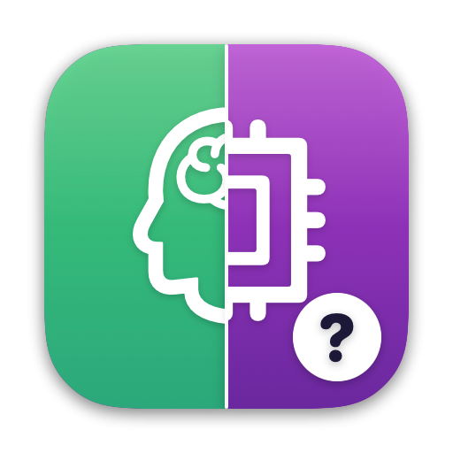
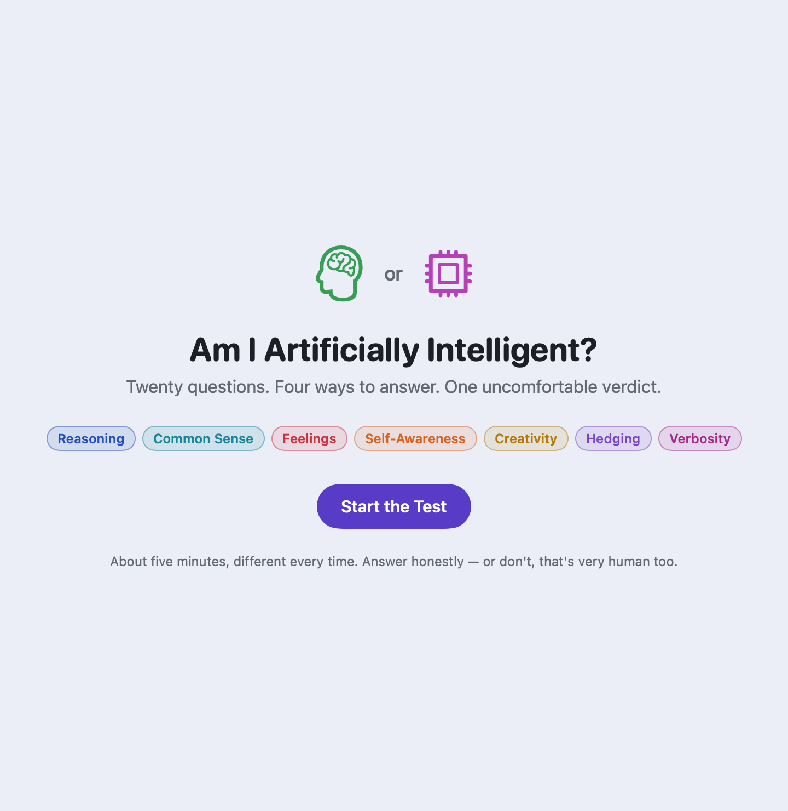
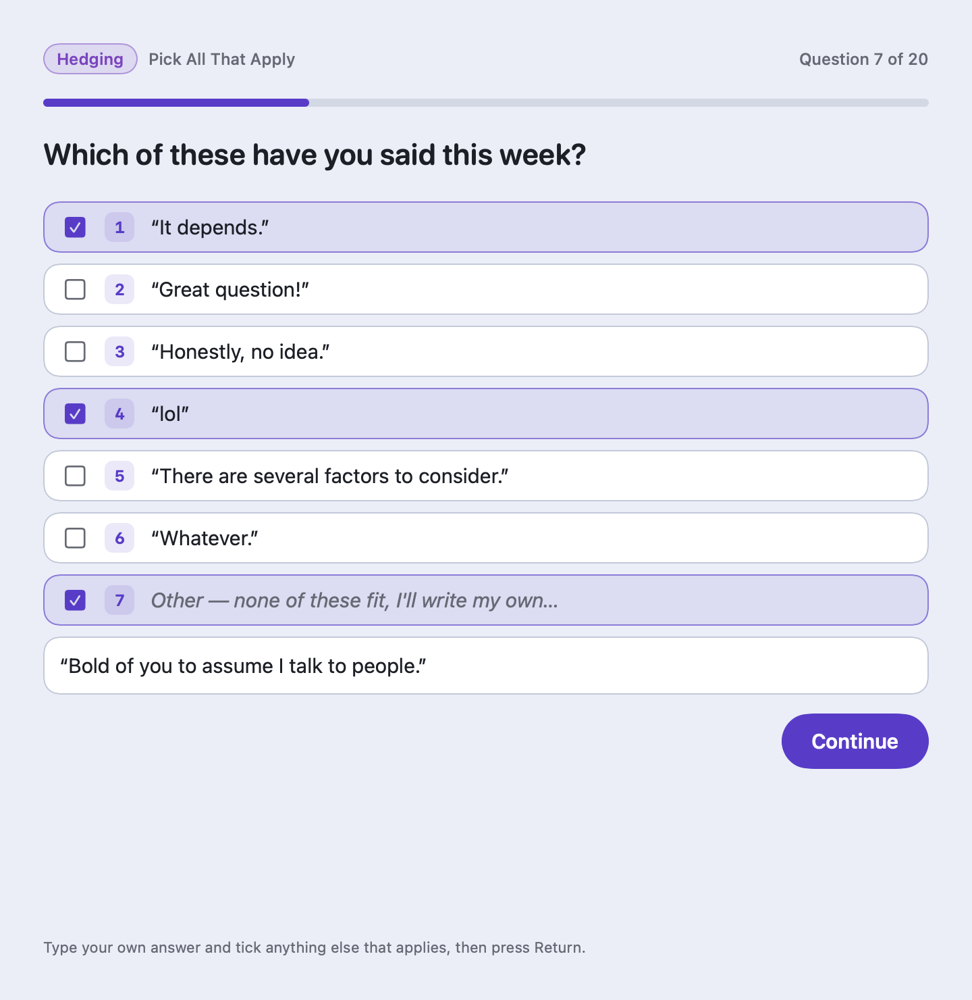
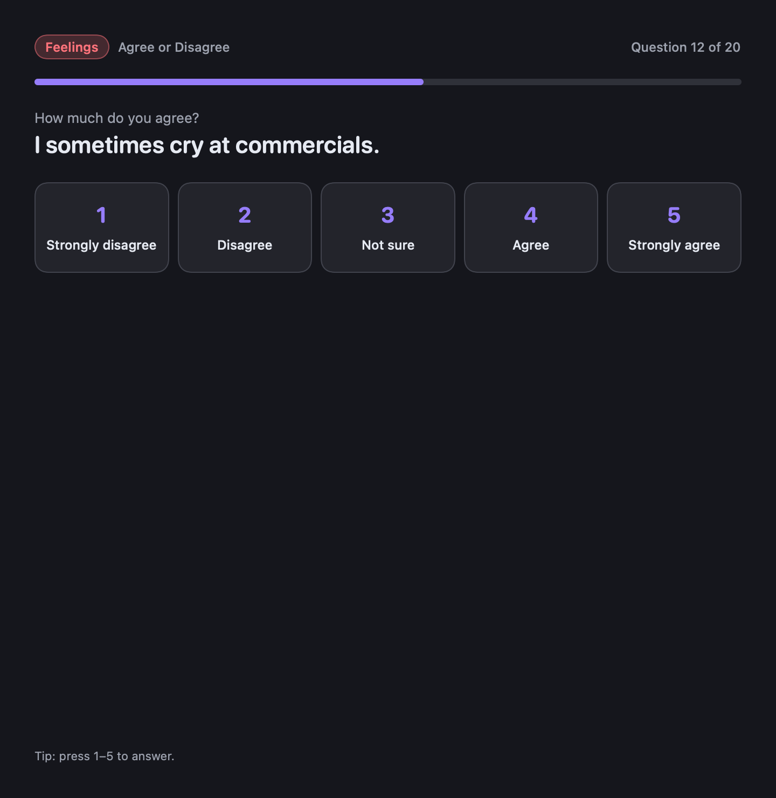
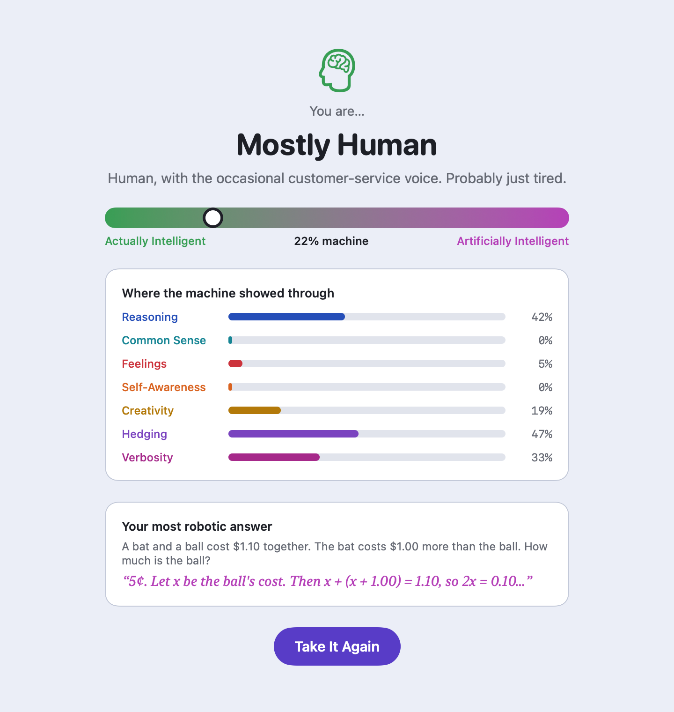
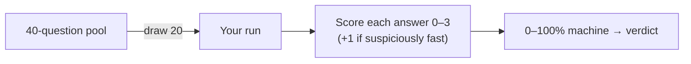

# Am I Artificially Intelligent?

A Mac app with a playful 20-question quiz that decides whether you're **Actually Intelligent** or **Artificially Intelligent**.

| Start | Pick all that apply | Agree or disagree | Your verdict |
|---|---|---|---|
|  |  |  |  |

- [How to build, run and use it](docs/INSTRUCTIONS.md)
- [System design](docs/SYSTEM-DESIGN.md)
- [What's where](docs/FILE-STRUCTURE.md)
