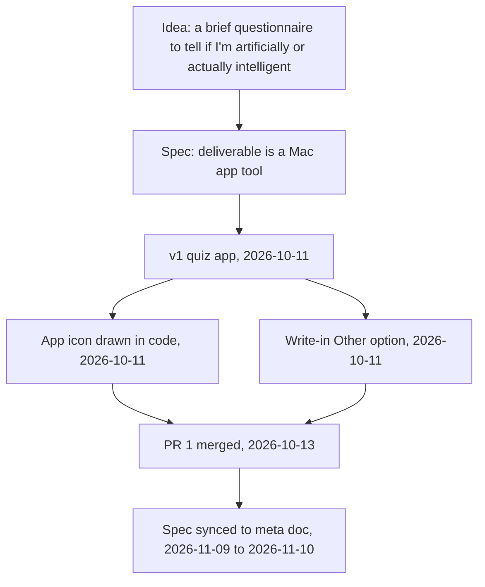
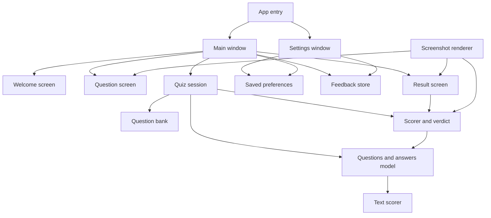
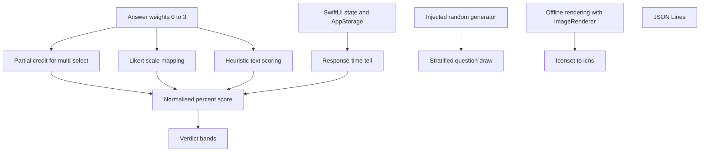

<!-- ProjectForge explainer at 2e8a1af -->
# How AmIArtificiallyIntelligent? was built

Am I Artificially Intelligent? is a playful Mac quiz. It asks you 20 questions and tells you whether your answers sound like a person or a chatbot. Its one idea: every possible answer has a fixed "machine weight" from 0 to 3, so the whole verdict is plain addition done on your Mac. There is no AI model and no network.

## Build history

No decisions were recorded from the build sessions, so this history comes from the idea and the commits alone.

- **v1 quiz app (2026-10-11).** First version: a Mac quiz app with a 40-question pool, four answer formats, and scoring done locally.
- **App icon (2026-10-11).** Added an icon that is half human and half chip, drawn in code, not in an image editor.
- **Write-in "Other" (2026-10-11).** Every choice question got an "Other" option, so you can type your own answer when no option fits.
- **PR #1 merged (2026-10-13).** The icon and write-in work, done on the `app-icon-and-write-in` branch, was merged into `main`.
- **Spec synced (2026-11-09 to 2026-11-10).** The spec was updated to match the author's current meta doc, the shared shortcuts were added, and then one more line from the meta doc was added: software should fit how people naturally interact with the world. These commits changed no app code.

## Code map

| Part | File | What it does |
|---|---|---|
| App entry | `Sources/AmIArtificiallyIntelligent/App.swift` | Opens the main window and the Settings window, applies the chosen theme, and quits when the last window closes. |
| Main window | `Sources/QuizUI/ContentView.swift` | Moves between welcome, quiz and result, times each answer, and hands answers to the session. |
| Welcome screen | `Sources/QuizUI/QuizViews.swift` (`WelcomeView`) | Title, the seven category chips, and the Start button. |
| Question screen | `Sources/QuizUI/QuestionView.swift` | Draws one question in its format, with number-key shortcuts and the write-in box. |
| Result screen | `Sources/QuizUI/QuizViews.swift` (`ResultView`, `Meter`, `CategoryBar`) | Shows the verdict, the 0–100 meter, per-category bars, and your most robotic answer. |
| Settings window | `Sources/QuizUI/SettingsView.swift` | Toggles for shuffle and speed scoring, a theme picker, and where feedback is saved. |
| Saved preferences | `Sources/QuizUI/Preferences.swift` | The `UserDefaults` key names, so Settings and the quiz read the same values, and the Light/Dark/System choice. |
| Feedback store | `Sources/QuizUI/Feedback.swift` | Adds each feedback note as one JSON line to a file in Application Support. |
| Colours | `Sources/QuizUI/Theme.swift` | Light and dark palettes, and one colour per category, grouped in hue families. |
| Quiz session | `Sources/QuizCore/QuizSession.swift` | Holds one run: the 20 drawn questions and the answers so far. |
| Question bank | `Sources/QuizCore/QuestionBank.swift` | The 40 questions with their weights, and `draw`, which picks a balanced 20. |
| Questions and answers model | `Sources/QuizCore/Model.swift` | Question, option, response and answer types, and `Question.points`, which scores one response. |
| Text scorer | `Sources/QuizCore/TextScorer.swift` | Scores typed text from 0 to 3 using phrase lists and a few style checks. |
| Scorer and verdict | `Sources/QuizCore/Scoring.swift` | Adds up the points, applies the speed bonus, and picks one of five verdicts. |
| Screenshot renderer | `Sources/ScreenshotRenderer/main.swift` | Renders the README screenshots from the real views, using fixed answers. |
| Icon renderer | `Sources/IconRenderer/main.swift`, `scripts/make-icon.sh` | Draws the icon in SwiftUI at 10 sizes and packs them into `Resources/AppIcon.icns`. |
| App bundle | `scripts/build-app.sh` | Builds a release binary, wraps it in a `.app` with an `Info.plist`, and signs it ad hoc. |
| Tests | `Tests/QuizCoreTests/QuizCoreTests.swift` | Tests the pool, the draw, per-question points, the text scorer, the speed bonus, and the verdict bands. |

`Package.swift` splits the code into a UI-free `QuizCore` library, a `QuizUI` library on top of it, and three executables: the app, the screenshot renderer and the icon renderer. Because `QuizCore` doesn't depend on SwiftUI, the tests can check all the scoring without opening a window.

## Concepts

**Answer weights** — Each option carries an `aiWeight` from 0 (clearly human) to 3 (clearly a chatbot). The weights were set by hand when the questions were written, and the `Option` initialiser rejects values outside 0–3. All other scoring is built on these numbers. Lives in `Sources/QuizCore/Model.swift` (`Option`) and `Sources/QuizCore/QuestionBank.swift`. A test checks that every choice question has at least one 0-weight answer and at least one answer weighted 2 or more (`Tests/QuizCoreTests/QuizCoreTests.swift`, `testChoiceQuestionsHaveAHumanAndAMachineAnswer`).

**Partial credit for multi-select** — On "pick all that apply" questions, you score the share of the question's total machine weight that you ticked, scaled to 0–3. If you also type a write-in, the ticks and the typed text count equally. This lets every format share the same 0–3 range. Lives in `Question.points`, `Sources/QuizCore/Model.swift`.

$$p_{\text{ticked}} = 3 \cdot \frac{\sum_{\text{ticked}} w}{\sum_{\text{all options}} w}, \qquad p = \frac{p_{\text{ticked}} + p_{\text{typed}}}{2} \text{ if there is a write-in}$$

Here $w$ is an option's `aiWeight` and $p_{\text{typed}}$ is the text scorer's result. Example: on "Which of these have you said this week?", the weights are 2, 3, 0, 0, 3, 0. Ticking only "It depends." gives $3 \cdot 2/8 = 0.75$. The test `testMultiplePicksArePartial` checks exactly this case.

**Likert scale mapping** — A Likert scale is the familiar 1–5 "strongly disagree" to "strongly agree" rating. Each statement says which end sounds like a machine (`machineAgrees`), and the rating maps in a straight line onto 0–3. Lives in `Question.points`, `Sources/QuizCore/Model.swift`.

$$a = \frac{v - 1}{4}, \qquad p = 3a \text{ if machineAgrees, else } 3(1 - a)$$

Here $v$ is the rating from 1 to 5 and $a$ is agreement from 0 to 1. "Not sure" ($v = 3$) always scores 1.5 (`testScaleMiddleIsHalfway`).

**Heuristic text scoring** — A heuristic is a rule of thumb, not a trained model. Free-text answers and write-ins are scored by counting chatbot phrases ("as an ai", "delve", "tapestry", "it's important to"…) and casual human markers ("lol", "idk", "!!", "…"), then adding small adjustments for length and tidiness. The project needs it because the spec chose offline, local rules over an AI model. Lives in `Sources/QuizCore/TextScorer.swift`.

$$s = \operatorname{clamp}_{[0,3]}\Big(0.5 + \min(r,2) + [n>40] + 0.5[n>80] + 0.5[\text{tidy}] - \min(h,2) - 0.5[\text{emoji}] - 0.5[\text{lowercase start}]\Big)$$

Here $r$ is the number of chatbot phrases found, $h$ the number of human markers found, $n$ the word count, and $[\cdot]$ is 1 when the condition holds and 0 when it doesn't. "Tidy" means the text starts with a capital letter and ends in "." or "!". Human markers made only of letters must match a whole word, so "nah" inside "banana" doesn't count (`testShortWordMarkersMatchWholeWordsOnly`). Chatbot phrases are matched anywhere in the text, so "consider" also matches "considerate". This is a joke detector, not a real one: anyone who knows the lists can steer it.

**Response-time tell** — When speed scoring is on, any clicked answer given in under 1.5 seconds adds one machine point. That question's maximum also goes up by one, so the score still runs 0–100. Typed answers (free text and write-ins) never count as fast (`Response.isTyped`). Timing starts when a question appears and stops when it's answered, in `ContentView.pick`, `Sources/QuizUI/ContentView.swift`. The bonus is applied in `Scorer.score`, `Sources/QuizCore/Scoring.swift`.

**Normalised percent score** — Earned points are divided by possible points, so the result is a percentage no matter which formats were drawn or whether speed scoring was on. The same sum is done separately for each category to get the bars on the result screen. Lives in `Scorer.score`, `Sources/QuizCore/Scoring.swift`.

$$\text{aiPercent} = \operatorname{round}\left(100 \cdot \frac{\sum_i (p_i + b_i)}{\sum_i (3 + e_i)}\right)$$

Here $p_i$ is question $i$'s points (0–3). $e_i$ is 1 if speed scoring is on and the answer was clicked, otherwise 0. $b_i$ is 1 if, on top of that, the answer took under 1.5 s. With all-human answers all clicked in 0.5 s, the score is $1/4 = 25\%$ (`testFastAnswersAddPointsOnlyWhenSpeedScoringIsOn`).

**Verdict bands** — The percentage is cut into five equal bands of 20 points: Actually Intelligent (under 20), Mostly Human, Uncanny Valley, Suspiciously Synthetic, and Artificially Intelligent (80 and up). Lives in `Verdict.forPercent`, `Sources/QuizCore/Scoring.swift`. The edges are tested in `testVerdictBands`.

**Stratified question draw** — Stratified sampling means drawing from each subgroup in proportion, not from the whole pool at once. The pool has 20 pick-one, 8 pick-all, 8 scale and 4 text questions. `QuestionBank.draw` gives each format a share of the 20 in proportion to its size: 10, 4, 4 and 2. It rounds each share down and hands any leftover slots to the biggest groups. Then it fills the scarcest formats first, each time taking the question whose category has been used least so far. This way every run has the same mix of formats and covers all seven categories, which `testDrawKeepsFormatMixAndSpreadsCategories` checks across 25 seeds. Lives in `Sources/QuizCore/QuestionBank.swift`.

**Injected random generator** — `QuestionBank.draw` and `QuizSession.init` accept any `RandomNumberGenerator`, not only the system one. The app passes the system generator (`QuizSession.init(count:shuffleAnswers:)`). The tests pass `SeededGenerator`, a linear congruential generator (each output is the last one times a constant plus a constant), so every shuffle repeats the same way. This is what makes the random draw testable. Lives in `Sources/QuizCore/QuizSession.swift` and `Tests/QuizCoreTests/QuizCoreTests.swift`.

**SwiftUI state and AppStorage** — `@State` is a value a SwiftUI view owns and redraws on when it changes. `@AppStorage` is the same, but the value is saved in `UserDefaults`, the Mac's per-app preferences store. The main window and the Settings window both read the same `PrefKey` keys, so a toggle in Settings reaches the quiz without any code that passes it along. `ContentView` sets `.id(q.id)` on each `QuestionView`, so every new question starts with fresh ticks and text. Lives in `Sources/QuizUI/ContentView.swift`, `Sources/QuizUI/SettingsView.swift` and `Sources/QuizUI/Preferences.swift`. One subtlety: Settings says speed scoring "takes effect on the next run". In fact `ContentView` reads the toggle again each time it draws the result, so flipping it while the result screen is open re-scores the run you just finished.

**Offline rendering with ImageRenderer** — `ImageRenderer` turns a SwiftUI view into an image without opening a window. The screenshot tool renders the real `WelcomeView`, `QuestionView` and `ResultView` in light and dark mode. To make this work, colours are picked explicitly per scheme in `Palette` instead of using system colours. The result screen can skip its `ScrollView`. And an `isStaticRender` flag swaps live text fields for plain text, because the renderer can't draw them. Lives in `Sources/ScreenshotRenderer/main.swift`, `Sources/QuizUI/Theme.swift`, `Sources/QuizUI/Preferences.swift` and `Sources/QuizUI/QuizViews.swift`.

**Iconset to icns** — macOS icons ship as one `.icns` file built from an `.iconset` folder of PNGs at fixed names and sizes (16 to 1024 pixels). `IconRenderer` draws the icon once at 1024×1024 in SwiftUI and renders it at 10 scales. Then `iconutil` packs them, and `build-app.sh` copies the result into the app bundle. Lives in `Sources/IconRenderer/main.swift`, `scripts/make-icon.sh` and `scripts/build-app.sh`.

**JSON Lines** — A text file with one JSON object per line, so new entries are added to the end without reading or rewriting the file. Each feedback note is saved as `{date, kind, message}` to `~/Library/Application Support/Am I Artificially Intelligent/feedback.jsonl`. Nothing is sent off the Mac. Lives in `FeedbackStore.save`, `Sources/QuizUI/Feedback.swift`.

## One input, start to finish

The input: on "Is a hot dog a sandwich?", you press the number key for "Great question! There are several perspectives worth considering…", about 4 seconds after the question appears. Speed scoring is on.

1. **Launch.** `AmIArtificiallyIntelligentApp.body` in `Sources/AmIArtificiallyIntelligent/App.swift` opens a window holding `ContentView`, which starts on the `.welcome` stage and shows `WelcomeView` (`Sources/QuizUI/QuizViews.swift`).
2. **Start.** Pressing Start runs `ContentView.start` (`Sources/QuizUI/ContentView.swift`). It builds `QuizSession(shuffleAnswers:)`, which calls `QuestionBank.draw` (`Sources/QuizCore/QuestionBank.swift`) to pick 20 questions. With shuffle on, it also reorders each choice question's options (`QuizSession.init`, `Sources/QuizCore/QuizSession.swift`). Options keep their ids: "Great question!…" stays `c` wherever it ends up on screen. Finally, `start` records `questionShownAt`.
3. **Show the question.** When `session.current` reaches the `hotdog` question, `ContentView.body` creates a `QuestionView` (`Sources/QuizUI/QuestionView.swift`). `answerArea` draws one `ChoiceRow` per option, plus the "Other" row. Each `ChoiceRow` has a keyboard shortcut for its on-screen number.
4. **Press the key.** The row's action calls `QuestionView.submit(.choice("c"))`. The `submitted` flag blocks a second press from answering the next question too. `submit` then calls `onAnswer`.
5. **Record it.** `ContentView.pick` measures `Date().timeIntervalSince(questionShownAt)` (about 4 s) and calls `QuizSession.answer(_:seconds:)`. That calls `Question.points(for:)` in `Sources/QuizCore/Model.swift`. The `(.single, .choice)` case looks up option `c` and returns its weight, 3.0. The answer is valid, so an `Answer(questionID: "hotdog", response: .choice("c"), seconds: 4)` is added to the list. `pick` resets the timer, and since 19 questions remain, the next `QuestionView` slides in.
6. **Finish.** After the 20th answer, `session.isFinished` is true and `pick` switches to `.result`. `ContentView.body` calls `session.result(speedThreshold: 1.5)`, which calls `Scorer.score` in `Sources/QuizCore/Scoring.swift`.
7. **Score.** For this answer, `Scorer.score` gets base points of 3 from `Question.points`. The answer was clicked, so the question's maximum becomes 4. It took 4 s, which is not under 1.5 s, so there's no bonus. The question adds 3 to `earned` and 4 to `possible`, and the same to the Hedging category. Its base of 3 is the highest possible, so it becomes `worst`, the most robotic answer, unless an earlier answer already scored 3 (the comparison is strictly greater than).
8. **Verdict.** `Scorer.score` rounds `earned / possible × 100` to an integer, picks a band with `Verdict.forPercent`, and builds a `CategoryScore` for each category that was asked. `Question.describe` turns `.choice("c")` back into its text.
9. **Show it.** `ResultView` (`Sources/QuizUI/QuizViews.swift`) shows the verdict title and blurb, the `Meter` at the percentage, one `CategoryBar` per category, and under "Your most robotic answer", the hot dog question with "Great question! There are several perspectives worth considering…". "Take It Again" calls `ContentView.start` for a fresh draw.

## Where this came from

Written from the spec (`AmIArtificiallyIntelligent?.md`), the decisions (none recorded), the git history and the code as of commit 2e8a1af.
