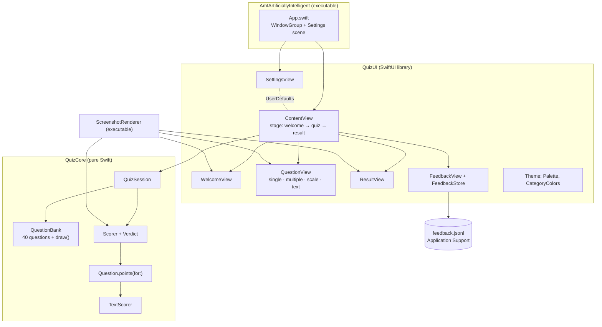

# System Design

Am I Artificially Intelligent? is a single-window SwiftUI Mac app. It draws 20 questions from a pool of 40, scores every answer locally for how machine-like it is, and shows a verdict. It makes no network calls.

## Architecture

## Components

| Component | Job |
|---|---|
| **QuizCore / Model** | The types: `Category` (7) grouped into `Family` (3), `Format` (single, multiple, scale, text), `Response`, `Question`, `Answer`. `Question.points(for:)` turns any response into 0–3 machine points, or `nil` if the response doesn't fit the question. |
| **QuizCore / QuestionBank** | The 40 questions: 20 pick-one, 8 pick-all-that-apply, 8 agree/disagree, 4 free text. `draw(count:)` keeps that format mix in proportion and spreads picks across categories. |
| **QuizCore / TextScorer** | Scores typed answers. Chatbot phrases ("as an AI", "it's important to", "tapestry"…), length over 40 or 80 words, and tidy capitalisation and punctuation push the score up. Slang ("lol", "idk", "tbh"), emoji, a lowercase start and "!!"/"…" pull it down. Clamped to 0–3. |
| **QuizCore / Scorer** | Adds up points, optionally +1 for clicked answers under 1.5 s, converts to a 0–100 percentage, and picks a verdict, the per-category percentages and the most robotic answer. |
| **QuizCore / QuizSession** | One run: the drawn questions, answer shuffling, and answers so far. It rejects responses that don't fit the current question. |
| **QuizUI / ContentView** | Owns the run, times each answer, switches stages, and hosts the gear button and feedback tab. |
| **QuizUI / QuestionView** | Draws the current format: choice rows, checkbox rows with Continue, a 1–5 scale, or a text field. Number-key shortcuts, plus a guard so a double press can't answer the next question too. |
| **QuizUI / Theme** | Explicit light and dark palettes, plus category colors by family. Colors are chosen in code rather than from system colors so `ImageRenderer` reproduces them exactly. |
| **ScreenshotRenderer** | Renders the real views to PNG with fixed answers, for the README. |

## Main flows

1. **Start**: `QuizSession(shuffleAnswers:)` calls `QuestionBank.draw(count: 20)` and optionally shuffles options.
2. **Answer**: `QuestionView` emits a `Response`. `ContentView` records it with the seconds since the question appeared, and the next question slides in.
3. **Verdict**: after 20 answers, `Scorer.score` produces a `QuizResult`, which `ResultView` renders as a meter, verdict, category bars and most robotic answer.
4. **Settings**: ⌘, opens the `Settings` scene. Values live in `UserDefaults` via `@AppStorage` and apply on the next run (theme applies immediately).
5. **Feedback**: the pill opens a sheet, and `FeedbackStore` appends one JSON line.

## Scoring

Each question is worth 0–3 points:

| Format | Points |
|---|---|
| Pick one | The option's weight (0–3) |
| Pick all that apply | 3 × (weight of picked options) ÷ (weight of all robotic options) |
| Agree or disagree | Linear across 1–5, toward whichever end is robotic |
| Free text | `TextScorer` |

When speed scoring is on, each non-text question's maximum becomes 4, with +1 for answers under 1.5 s. Percentage = earned ÷ possible. Verdict bands: under 20 → Actually Intelligent, under 40 → Mostly Human, under 60 → Uncanny Valley, under 80 → Suspiciously Synthetic, otherwise Artificially Intelligent.

## Where data lives

| Data | Location |
|---|---|
| Questions | Compiled in (`QuestionBank.swift`) |
| Preferences | `UserDefaults` (`com.amalmehta.AmIArtificiallyIntelligent`) |
| Feedback | `~/Library/Application Support/Am I Artificially Intelligent/feedback.jsonl` |
| Quiz runs and results | Memory only; never saved |

## Key decisions and trade-offs

- **Local rule-based scoring instead of an LLM judge.** Offline, free, instant, deterministic and testable. The cost is that free-text scoring is a rough keyword heuristic, and that suits a playful quiz.
- **Pool of 40, draw 20, stratified by format and category.** Repeat runs feel fresh while every run keeps the same format mix and touches every category, so the breakdown is always complete.
- **One 0–3 scale for every format.** Formats are directly comparable, and the overall percentage isn't skewed by multi-select questions with many options.
- **Speed tell skips typed answers.** You can't type fast enough for it to mean anything, and paste-speed is not the point.
- **SwiftPM, not an Xcode project.** Builds and tests from the command line. `build-app.sh` assembles the `.app` bundle by hand. The trade-off is no asset catalog, so there's no custom app icon yet.
- **Views split into a library** (`QuizUI`) so the screenshot renderer uses the exact same views as the app.
- **Explicit palettes per color scheme**, rather than dynamic system colors, so offline renders match the app. Category colors share a hue per family: Thinking is blue and teal, Heart is red, orange and amber, Machine Tells is violet and magenta.

## Testing

`swift test` runs 25 XCTest cases over `QuizCore`:

- bank integrity: 40 questions, unique ids, every format and category present
- the draw: format quotas and full category coverage over 25 seeds, no duplicates
- points per format, including extremes, partial multi-select and the scale midpoint
- rejection of mismatched and empty responses
- text scorer, high and low, clamping and whole-word matching
- verdict bands, speed bonus, and the session lifecycle

UI was checked by rendering every screen in light and dark (`ScreenshotRenderer`) and by driving the built app (start, number-key answers, shuffling, results, restart).

## Known limits

- Free-text scoring is keyword-based and easy to game. That's on purpose.
- Results aren't saved, and there's no history or sharing.
- No custom app icon. The bundle is ad-hoc signed, not notarized.
- The question pool is fixed in code. Adding questions means editing `QuestionBank.swift`.
- English only.
